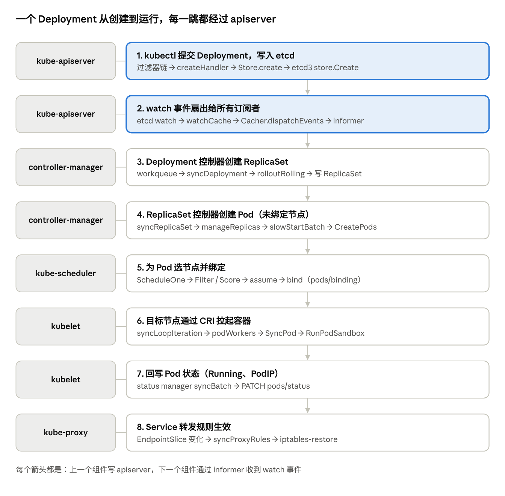

# Kubernetes v1.31 源码架构与调用链精讲

2026-11-06 · 基于 kubernetes release-1.31（v1.31.14）

## 环境与解析说明

源码为 `release-1.31` 分支（HEAD `fa33e07f`，即 v1.31.14），并用 Understand-Anything 的 `/understand` 流程生成了核心组件知识图谱 `.ua/knowledge-graph.json`，图谱校验 0 个问题。

| 项目 | 结果 |
| --- | --- |
| 解析方式 | `/understand --full`：82 批 file-analyzer 逐文件精读，每批对照输入核验节点完整性 |
| 解析范围 | 5 个 cmd 入口 + apiserver / client-go / scheduler / controller / kubelet / kube-proxy 核心包 |
| 节点 | 1035 文件、326 包、7894 函数、1254 类型，共 10509 个；9340 个带中文摘要 |
| 边 | 6435 调用、1562 包导入、431 接口实现、536 运行时依赖、212 概念关联 |
| 分层 / 导览 | 9 个架构层、14 步学习导览；插件校验器 0 问题、0 孤立节点 |

安装有一处偏差：工作区禁止访问 npm 仓库，插件依赖的 tree-sitter、graphology 装不上，所以它的 Node 结构抽取脚本和可视化 Dashboard 无法构建。结构抽取改用 Go 自带的 `go/ast` 实现；语义分析、合并（`merge-batch-graphs.py`）和校验都按插件流程执行，摘要由子代理读完源码后写成。

接口实现关系用 Go 编译器的类型检查（`go/types`）对 326 个包精确计算，共 427 条，覆盖包内私有 struct，例如 `staticPolicy → Policy`、`stateCheckpoint → State`。静态分析看不到的接口分发调用（如 `handler.HandlePodAdditions`）由分析代理读码补充，另有 7 条我核对过的关键边，描述里标注了「人工补充」。

仍有两点局限：1169 个短小的私有函数沿用源码英文注释作摘要；53 条指向解析范围外包（如 `apiserver/pkg/warning`）的边在合并时被丢弃。

图谱目录里附带了命令行查询工具 `ua-query.py`，不装插件也能用：在 kubernetes 根目录运行 `python3 .ua/ua-query.py show Scheduler.ScheduleOne` 查看摘要和调用关系，`chain` 展开调用树，`impl` 查接口实现，`pkg` 看包摘要，`tour` 看导览。在能联网的机器上用 `/plugin marketplace add Egonex-AI/Understand-Anything` 装好插件后，把 `.ua/` 放到 kubernetes 根目录，运行 `/understand-dashboard` 即可可视化浏览。

## 整体架构：一个数据库，多个调谐循环

Kubernetes 的核心设计是：kube-apiserver 是唯一读写 etcd 的组件，其余组件都不互相调用，而是通过 list-watch 订阅 apiserver 的对象变化，各自把实际状态推向期望状态。

读源码时抓住三条设计原则，几乎所有代码都能对上：

1. **声明式 API + 水平触发**：控制器只比较「期望 vs 实际」，不依赖事件本身，丢事件也能靠 resync 和下一次事件收敛。
2. **乐观并发**：每个对象带 `resourceVersion`（来自 etcd revision），更新失败返回 409 Conflict，由调用方重试，没有分布式锁。
3. **组件解耦**：调度器只写 `pods/binding`，kubelet 只认 `spec.nodeName`，controller 只改副本数，彼此通过对象字段协作。

| 组件 | 进程入口 | 核心循环 | 写回 apiserver 的内容 |
| --- | --- | --- | --- |
| kube-apiserver | `cmd/kube-apiserver/app/server.go` | HTTP 请求处理 + Cacher watch 扇出 | etcd 中的全部对象 |
| kube-controller-manager | `cmd/kube-controller-manager/app/controllermanager.go` | 每个控制器的 workqueue worker | ReplicaSet、Pod、Endpoints 等派生对象 |
| kube-scheduler | `cmd/kube-scheduler/app/server.go` | `Scheduler.ScheduleOne` | `pods/binding` |
| kubelet | `cmd/kubelet/app/server.go` | `Kubelet.syncLoop` | `pods/status`、Node 状态、Lease |
| kube-proxy | `cmd/kube-proxy/app/server.go` | `Proxier.SyncLoop` | 不写，只改本机 iptables/ipvs/nftables |

下面每节按「入口 → 主循环 → 关键函数」讲，所有函数名和行号都来自 v1.31.14 源码。

## kube-apiserver：委托链 → 过滤器链 → Handler → 存储

apiserver 由三个 GenericAPIServer 串成委托链，每个请求先经过统一的过滤器链，再由按资源生成的 Handler 调用 `Store`，最终经 `Cacher` 和 etcd3 落盘。

**启动链路**（`cmd/kube-apiserver/app/server.go`）：

1. `NewAPIServerCommand`（:66）解析 flag → `Run`（:140）。
2. `CreateServerChain`（:168）按从内到外的顺序构建：`apiExtensionsServer`（CRD，委托给 notFoundHandler）→ `kubeAPIServer`（内置资源，委托给前者）→ `aggregatorServer`（APIService 聚合，最外层）。
3. 请求进来时反向查找：Aggregator 没有路由就交给 KubeAPIServer，再交给 APIExtensions，最后 404。
4. `GenericAPIServer.PrepareRun`（genericapiserver.go:422）装 OpenAPI、healthz → `preparedGenericAPIServer.RunWithContext`（:503）→ `NonBlockingRunWithContext`（:729）→ `SecureServingInfo.Serve` 开始监听。

内置资源的安装在 `pkg/controlplane/instance.go` 的 `CompletedConfig.New`（:309）：为 `/api/v1` 和每个 API 组创建 RESTStorage，再由 `endpoints/installer.go` 的 `registerResourceHandlers` 根据 Storage 实现了哪些接口（Getter、Creater、Watcher…）生成 go-restful 路由。

**过滤器链**（`apiserver/pkg/server/config.go` 的 `DefaultBuildHandlerChain`，:998）。代码里是从内向外包装的，所以请求的实际执行顺序是：

1. `WithAuditInit` → `WithPanicRecovery` → `WithRequestInfo`（解析出 verb、resource、namespace）
2. `WithWaitGroup` / `WithRequestDeadline` / `WithTimeoutForNonLongRunningRequests`（优雅关闭和超时）
3. `WithAuthentication`：证书、Token、ServiceAccount、OIDC，写入 user.Info
4. `WithAudit` → `WithImpersonation`
5. `WithPriorityAndFairness`（APF 限流，关闭时退化为 `WithMaxInFlightLimit`）
6. `WithAuthorization`：Node、RBAC、Webhook 鉴权
7. 进入 `APIServerHandler`，Director 分发到 go-restful 或 NonGoRestfulMux

**一个 POST 的处理**（`endpoints/handlers/create.go` 的 `createHandler`，:53）：解码请求体并转换到内部版本 → 执行 mutating admission → 调用 `r.Create`，并把 validating admission 包成 `createValidation` 传下去。

**存储三层**：

| 层 | 文件 | 职责 |
| --- | --- | --- |
| `Store` | `registry/generic/registry/store.go` | `create`（约 :458）里执行 `rest.BeforeCreate` 策略 → `createValidation` → `KeyFunc` 算 etcd key → `e.Storage.Create` |
| `Cacher` | `storage/cacher/cacher.go` | 由 `StorageWithCacher` 装饰器包在 etcd3 外面；`Watch`（:516）和一致性允许的 `GetList` 直接走 watchCache，`dispatchEvents`（:1022）把一次 etcd watch 扇出给所有 watcher |
| etcd3 `store` | `storage/etcd3/store.go` | `Create`（:194）用事务 `If(ModRevision==0)` 防重复；`GuaranteedUpdate`（:389）是 CAS 重试循环，乐观并发的落地点 |

学习建议：在 `Store.create` 和 `etcd3.store.Create` 下断点，跑一遍 `kubectl create`，三层关系会一目了然。

## client-go：Informer + workqueue，所有控制器的底座

scheduler、controller-manager、kubelet、kube-proxy 读集群状态全部依赖 SharedInformer：一次 list-watch 填充本地缓存，事件转成 key 进 workqueue，worker 再从缓存读对象做调谐。

**数据从 apiserver 流到你的 handler**（`staging/src/k8s.io/client-go/tools/cache/`）：

1. `Reflector.Run`（reflector.go:304）用 `wait.BackoffUntil` 循环调用 `ListAndWatch`（:340）。
2. `list`（:494）全量 LIST，拿到 `resourceVersion`；然后 `watch`（:410）从该版本开始接收增量；遇到 410 Gone（版本太旧）就重新 list。
3. 每个事件写入 `DeltaFIFO.queueActionLocked`（delta\_fifo.go:439），同一对象的增量按 key 聚合成 `Deltas`。
4. `controller.processLoop`（controller.go:193）不断 `Pop`（delta\_fifo.go:576），交给 `Process` 函数，也就是 `sharedIndexInformer.HandleDeltas`（shared\_informer.go:638，在 :486 注册）。
5. `processDeltas` 先更新 Indexer（`threadSafeMap` 本地缓存），再调用 `OnAdd` / `OnUpdate` / `OnDelete`。
6. `sharedProcessor.distribute`（:779）把通知发给每个 `processorListener`；listener 的 `pop`（:936）用无界缓冲解耦，`run`（:966）调用用户注册的 EventHandler。

**控制器的标准写法**（Deployment、ReplicaSet 都是这个模板）：

1. EventHandler 里只做一件事：把对象 key（`namespace/name`）放进 workqueue。
2. N 个 worker 循环 `Get()` → `syncHandler(key)` → `Done()`。
3. sync 失败 `AddRateLimited` 退避重试，成功 `Forget`。
4. sync 里从 Lister（本地缓存）读对象，不直接请求 apiserver。

workqueue（`util/workqueue/queue.go`）有两个关键集合：`dirty`（待处理，`Add` :240 时去重）和 `processing`（处理中，`Done` :302 之前同一 key 不会被第二个 worker 拿到）。这两个集合保证了同一对象串行处理，又不会堆积重复事件。

**选主**：多副本的 scheduler 和 controller-manager 通过 `LeaderElector.Run`（leaderelection.go:208）竞争 Lease 对象，`acquire`（:249）抢锁，`renew`（:275）周期续约，续约失败即退出进程，避免脑裂。

## 控制器：Deployment → ReplicaSet → Pod

kube-controller-manager 是几十个独立控制器的容器，它们共享一个 InformerFactory；Deployment 控制器只管 ReplicaSet，ReplicaSet 控制器只管 Pod，层层委托。

**进程启动**（`cmd/kube-controller-manager/app/controllermanager.go`）：`Run`（:192）先选主 → `CreateControllerContext`（:616）创建共享 InformerFactory → `NewControllerDescriptors`（:516）注册所有控制器 → `StartControllers`（:688）逐个调用启动函数（如 `apps.go` 中的 Deployment 启动函数）→ 最后统一 `InformerFactory.Start`。

**Deployment 调谐**（`pkg/controller/deployment/deployment_controller.go`）：

1. `addDeployment`（:187）、`addReplicaSet`（:219）等 handler 找到所属 Deployment，`enqueue`（:400）。
2. `Run`（:162）启动 worker → `processNextWorkItem`（:487）→ `syncDeployment`（:590）。
3. `syncDeployment` 的分发逻辑：`getReplicaSetsForDeployment` 认领 RS → 暂停则 `sync` → 有回滚请求则 `rollback` → `isScalingEvent` 为真则 `sync`（只扩缩容）→ 否则按策略进入 `rolloutRecreate` 或 `rolloutRolling`。
4. `rolloutRolling`（rolling.go:31）：`reconcileNewReplicaSet`（:68）按 maxSurge 扩新 RS，`reconcileOldReplicaSets`（:86）按 maxUnavailable 缩旧 RS，每轮只走一小步，等下一次事件再继续。

**ReplicaSet 调谐**（`pkg/controller/replicaset/replica_set.go`）：`syncReplicaSet`（:675）对比期望副本与实际 Pod，`manageReplicas`（:569）处理差值：

- 每次最多处理 `burstReplicas` 个，防止一次压垮 apiserver。
- 创建前调用 `expectations.ExpectCreations`，在 informer 看到这些 Pod 之前不会重复创建——这是解决「缓存滞后」的关键设计。
- `slowStartBatch`（:771）按 1、2、4、8… 指数批量创建，早期失败就停，避免对配额不足等错误狂刷。
- 缩容由 `getPodsToDelete` 选择，优先删未调度、未就绪、新创建的 Pod。

**垃圾回收**（`garbagecollector/garbagecollector.go`）：Deployment 被删时，它不直接删 RS；GC 根据 `ownerReferences` 构建依赖图，按 Background / Foreground / Orphan 策略级联删除。

## 调度器：同步的调度周期 + 异步的绑定周期

调度器一次只调度一个 Pod：调度周期串行执行（保证缓存一致），选好节点后先 assume 进缓存，再起 goroutine 异步绑定，所以吞吐不受 apiserver 写延迟拖累。

**启动**（`cmd/kube-scheduler/app/server.go`）：`runCommand`（:134）→ `Setup`（:384）构建 `Scheduler`（profiles、插件注册表、informer 事件处理）→ `Run`（:163）启动 informer、等待缓存同步、选主 → `Scheduler.Run`（scheduler.go:460）启动调度队列，并用 `wait.UntilWithContext(ctx, sched.ScheduleOne, 0)` 无间隔循环。

**ScheduleOne**（`pkg/scheduler/schedule_one.go`:65）：

1. `NextPod` 从 `PriorityQueue` 的 activeQ 弹出优先级最高的 Pod。
2. `schedulingCycle`（:138）调用 `SchedulePod`（默认指向 `schedulePod`，:400）：
   1. `Cache.UpdateSnapshot` 生成本轮的节点快照。
   2. `findNodesThatFitPod`（:452）：`RunPreFilterPlugins` → `findNodesThatPassFilters`（:582）用 `Parallelizer().Until` 并行跑 Filter，找到 `numFeasibleNodesToFind` 个可行节点就提前停止（大集群只评估部分节点）→ Extender 过滤。
   3. `prioritizeNodes`（:754）：PreScore → Score → 归一化 × 权重 → Extender 打分。
   4. `selectHost` 在最高分中随机选一个。
3. 没有可行节点：`RunPostFilterPlugins`，即默认的抢占（DefaultPreemption）尝试驱逐低优先级 Pod，并设置 nominatedNodeName。
4. 有节点：`assume`（:945）把 Pod 写入调度缓存（视同已调度，后续 Pod 能看到资源被占）→ `RunReservePluginsReserve` → `RunPermitPlugins`（可返回 Wait，用于 gang 调度）。
5. `go bindingCycle`（:264）：`WaitOnPermit` → `RunPreBindPlugins`（如卷绑定）→ `bind`（:967，默认 `DefaultBinder` 发 `pods/binding`）→ `RunPostBindPlugins`。任一步失败执行 Unreserve，并把 Pod 从缓存移除后重新入队。

**扩展点就是插件接口**：`framework/interface.go` 定义了全部扩展点，`framework/runtime/framework.go` 负责按 profile 实例化和调用。写自定义调度逻辑时，实现接口并在 KubeSchedulerConfiguration 中启用即可，不用改调度器主流程。

**调度队列**（`internal/queue/scheduling_queue.go`）有三个子队列：activeQ（堆）、backoffQ（指数退避）、unschedulablePods。集群事件（如节点新增、Pod 删除）发生时，QueueingHint 判断哪些不可调度的 Pod 值得重试，避免无谓重算。

## kubelet：syncLoop → podWorkers → CRI

kubelet 的核心是一个事件多路复用循环加「每 Pod 一个 goroutine」的状态机：任何来源的变化都只是触发一次 `SyncPod`，由 `SyncPod` 根据期望与实际的差异决定要做什么。

**启动**（`cmd/kubelet/app/server.go`）：`Run`（:489）→ `run`（:568，初始化 ContainerManager、cgroup、CRI 客户端）→ `RunKubelet`（:1212）→ `createAndInitKubelet`（:1293）→ `startKubelet`（:1279）启动 `Kubelet.Run` 和 10250 端口服务。

**主循环**（`pkg/kubelet/kubelet.go`）：`Run`（:1596）启动 volumeManager、statusManager、PLEG、probeManager 等后进入 `syncLoop`（:2320）。`syncLoopIteration`（:2394）用 select 同时监听：

| 通道 | 来源 | 处理 |
| --- | --- | --- |
| `configCh` | `config/config.go` 的 PodConfig 合并 apiserver、静态文件、HTTP 三个来源 | ADD → `HandlePodAdditions`，UPDATE / REMOVE / DELETE 对应其他 Handle 函数 |
| `plegCh` | `pleg/generic.go` 的 `Relist` 每 1 秒对比运行时状态 | 容器状态变化 → `HandlePodSyncs` |
| `syncCh` | 定时器 | 到期需要重新同步的 Pod |
| 探针更新 | liveness / readiness / startup manager | 更新状态，必要时触发同步 |
| `housekeepingCh` | 定时器 | 清理孤儿 Pod、卷、cgroup |

`HandlePodAdditions`（:2534）按创建时间排序，`canAdmitPod` 做准入（资源、亲和性、污点等），通过后调用 `podWorkers.UpdatePod`。

**podWorkers**（`pod_workers.go`）：`UpdatePod`（:735）合并对同一 Pod 的更新，每个 Pod 一个 `podWorkerLoop`（:1214），按状态调用 `podSyncer` 接口的 `SyncPod`、`SyncTerminatingPod` 或 `SyncTerminatedPod`。生命周期严格单向：syncing → terminating → terminated。

**Kubelet.SyncPod**（kubelet.go:1750）：`generateAPIPodStatus` 并 `statusManager.SetPodStatus` → 创建 Pod 级 cgroup（`pcm.EnsureExists`）→ `makePodDataDirs` → `volumeManager.WaitForAttachAndMount` 等卷就绪 → `probeManager.AddPod` → `containerRuntime.SyncPod`。

**kubeGenericRuntimeManager.SyncPod**（`kuberuntime/kuberuntime_manager.go`:1052），源码里直接标注了步骤：

1. `computePodActions`：算出 sandbox 是否需重建、哪些容器要杀、要启动。
2. sandbox 变化则 `killPodWithSyncResult` 杀掉整个 Pod。
3. 杀掉不再需要的容器。
4. `createPodSandbox`（kuberuntime\_sandbox.go:41）：调用 CRI `RunPodSandbox`，由运行时创建 pause 容器并调用 CNI 配网。
5. 启动 ephemeral 容器。
6. 启动 init 容器（一次一个，按顺序）。
7. 原地调整容器资源（InPlacePodVerticalScaling）。
8. 启动普通容器：`startContainer`（kuberuntime\_container.go:195）→ `EnsureImageExists` 拉镜像 → CRI `CreateContainer` → `StartContainer` → 执行 PostStart hook。

状态回写由 `status/status_manager.go` 的 `syncBatch`（:764）完成，通过 PATCH `pods/status` 写回 apiserver。

## kube-proxy：变更跟踪 + 限频同步

kube-proxy 不处理任何流量，它只把 Service 和 EndpointSlice 翻译成本机内核规则；事件只负责「记账」，真正改规则由一个限频的同步循环完成。

1. `ProxyServer.Run`（`cmd/kube-proxy/app/server.go`:480）创建 InformerFactory，`NewServiceConfig`（:540）和 `NewEndpointSliceConfig`（:544）把事件注册到 Proxier，`go s.Proxier.SyncLoop()`（:583）。
2. `OnServiceAdd`（`pkg/proxy/iptables/proxier.go`:560）、`OnEndpointSliceAdd`（:593）等只把变化写进 `ServiceChangeTracker` / `EndpointsChangeTracker`，然后 `syncRunner.Run()` 请求一次同步。
3. `syncRunner` 是 `BoundedFrequencyRunner`（:328 创建），保证两次同步间隔不小于 `minSyncPeriod`，同时 `forceSyncProxyRules` 至少每个 `syncPeriod` 做一次全量同步（:331）。
4. `SyncLoop`（:535）→ `syncRunner.Loop` → `syncProxyRules`（:799）：合并变更到 ServicePortMap / EndpointsMap → 生成 `KUBE-SERVICES` → `KUBE-SVC-*`（按概率负载均衡）→ `KUBE-SEP-*`（DNAT 到 Pod IP）等链 → 一次 `iptables-restore` 原子写入。

两个值得读的优化：`needFullSync` 为假时只重写有变化的 Service 链；`largeClusterMode`（:199）在端点数量很大时减少规则注释等开销。

三种模式同构：`ipvs/proxier.go` 用 IPVS 虚拟服务 + ipset，`nftables/proxier.go`（1.31 为 beta）用 nft 的 map/set，入口函数名（`SyncLoop`、`syncProxyRules`）都一样，可以对照阅读。

## 端到端：kubectl create deployment 的全链路

把前面各节串起来：一个 Deployment 从提交到可访问要经过 8 跳，组件之间从不直接调用，全部是「写 apiserver → 下游 informer 收到事件 → 调谐」。

排查「Pod 起不来」时就沿着这条链定位：卡在第 4 跳看 RS 事件和配额，卡在第 5 跳看 `kubectl describe pod` 的调度事件，卡在第 6 跳看 kubelet 日志和 `crictl`。

## 学习路线与图谱使用方法

建议按「client-go → apiserver → 控制器 → 调度器 → kubelet → kube-proxy」的顺序读：client-go 是其他组件的共同语言，先吃透它，后面每个组件都只是不同的 sync 函数。图谱里的 14 步导览就是这个顺序。

| 阶段 | 目标 | 先读的文件 | 动手验证 |
| --- | --- | --- | --- |
| 1 | 理解 list-watch | `reflector.go`、`shared_informer.go`、`queue.go` | 写一个只打印 Pod 事件的小程序 |
| 2 | 一个请求的一生 | `server/config.go`、`handlers/create.go`、`registry/store.go`、`etcd3/store.go` | `kubectl create -v=8` 对照日志，用 `etcdctl get /registry/pods --prefix --keys-only` 看 key |
| 3 | 调谐模式 | `deployment_controller.go`、`rolling.go`、`replica_set.go` | 改 maxSurge 后观察 RS 副本数变化 |
| 4 | 调度算法 | `schedule_one.go`、`framework/interface.go` | 写一个 Filter 插件，用 kind 集群验证 |
| 5 | 节点侧 | `kubelet.go`、`pod_workers.go`、`kuberuntime_manager.go` | `crictl pods` / `crictl ps` 对照 SyncPod 的 8 个步骤 |
| 6 | 网络 | `iptables/proxier.go` | `iptables-save -t nat \| grep KUBE-SVC` |

**用图谱查调用关系**（文件在 `kubernetes/.ua/knowledge-graph.json`）：

- 节点 id 规则：`file:<路径>`、`function:<路径>:<类型.方法>`、`class:<路径>:<类型>`、`module:<包目录>`。
- 查某函数调了谁：筛 `type == "calls"` 且 `source` 为该函数的边；反过来查谁调了它，就按 `target` 筛。
- `layers` 字段按 9 个架构层分组了全部文件，`tour` 字段是导览步骤。
- 带「人工补充」描述的边是接口分发，静态分析看不到，读源码时要特别留意这类跳转。

在能联网的机器上安装插件后，`/understand-chat` 可以直接对这份图谱提问，`/understand-explain pkg/scheduler/schedule_one.go` 可深挖单个文件。若想扩大解析范围（如加入 `pkg/registry` 或 `kubectl`），在 kubernetes 根目录运行 `/understand <子目录> --language zh`，插件会对该目录重新分析，并可与现有图谱合并。
